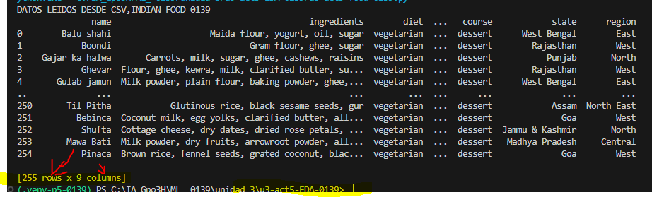
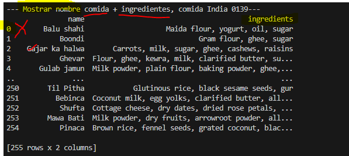
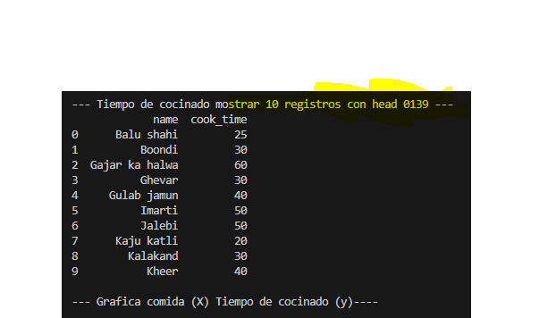
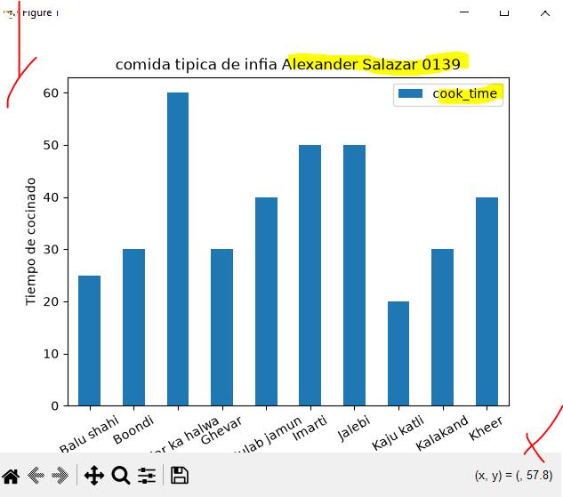
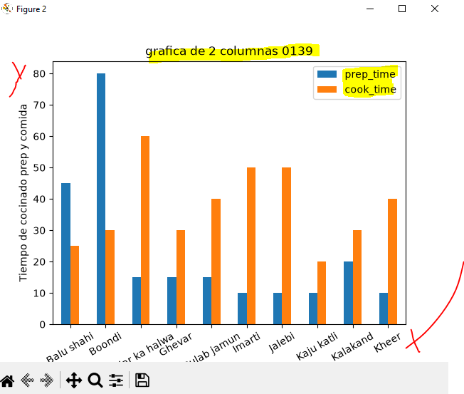
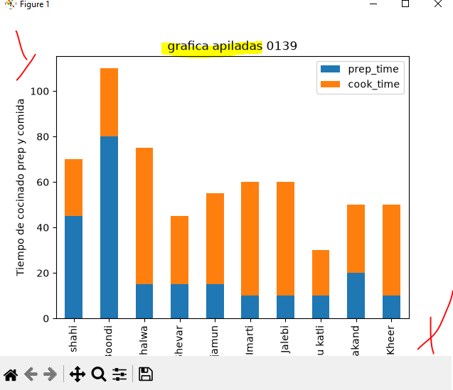

## Analisis exploratorio de datos
## Comida del pais de la india
## Alexander Salazar 0139
## -+-+- Importando datos del archivo CSV Comida india

## mostrar nombre comida + mas ingredientes

## tiempo de cocinado mostrar 10 registros con head

## creacion de graficas de barra 0139

## creacion de graficas de Varias columnas 0139

## grarfica apiladas 0139
